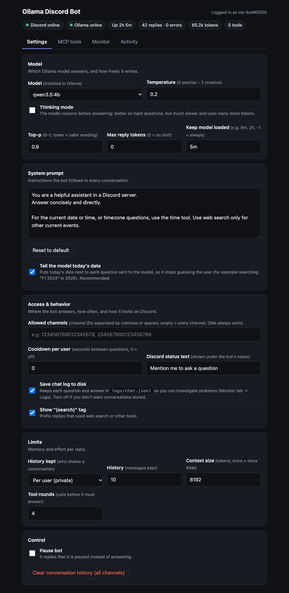
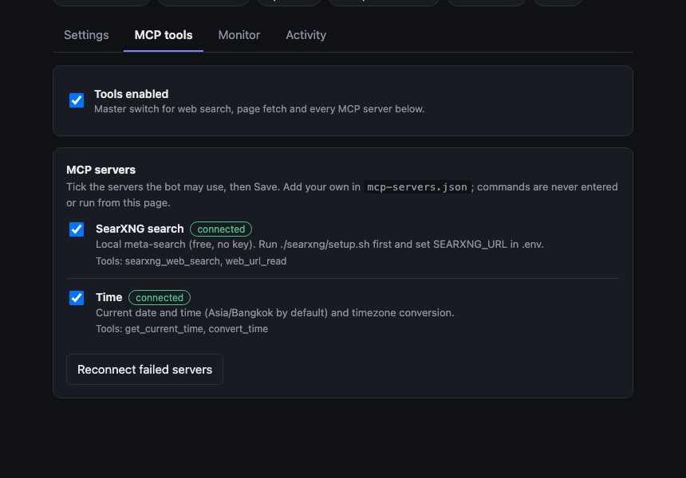
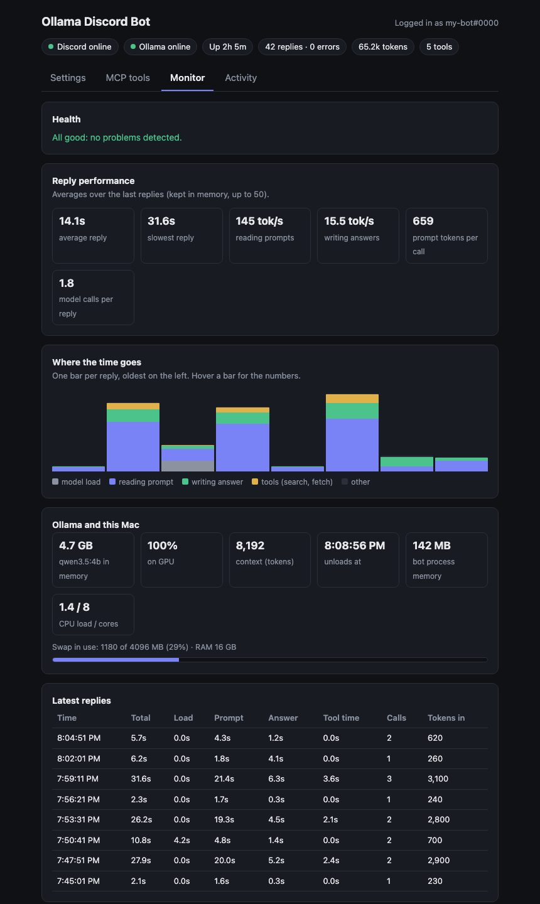
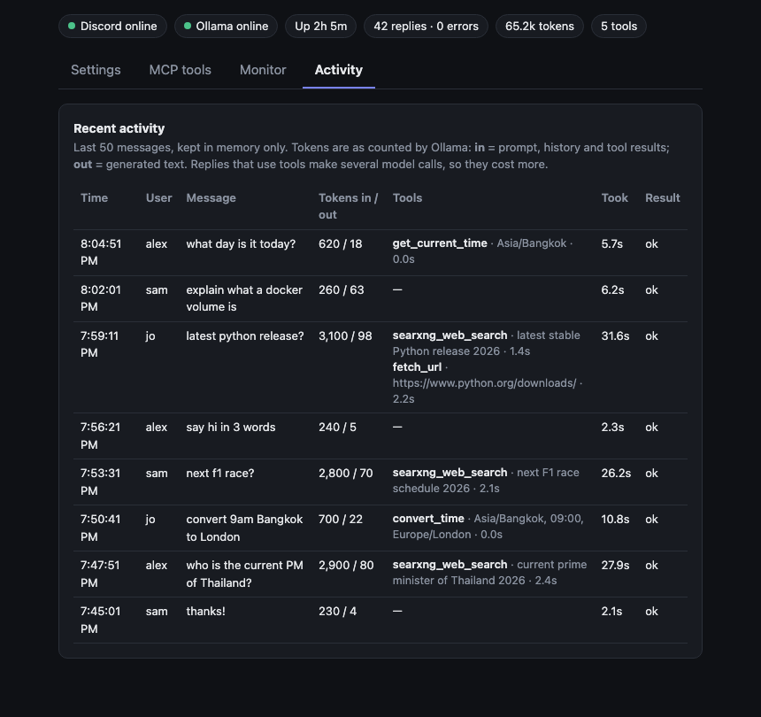

# ollama-discord

A Discord bot that answers with a **local** Ollama model: no cloud API, no subscription, your messages stay on your machine. It can search the web and use other tools through MCP, and comes with a web dashboard to change its settings live and see how it is performing.

- Per-user conversations, so two people talking to the bot in one channel never mix
- Web search through a local SearXNG (free, no API key), plus any MCP server you add (date/time, ...)
- Dashboard: change model, prompt and limits without restarting; choose MCP servers; monitor speed, memory and errors; browse logs
- Chat commands: `--help`, `--info`, `--reset`
- Two log files on disk (bot log and chat log) for investigating problems

## Requirements
- [Ollama](https://ollama.com) (a recent version; newer models need newer Ollama) and Node.js 20.6 or newer
- A Discord bot token
- Docker, only for the local web search (SearXNG)
- Python 3, only for the optional Time MCP server

## Setup
1. Install Ollama and pull a model:
   ```
   ollama pull qwen2.5:7b
   ```
   The default model is `qwen2.5:7b`. See [Choosing a model](#choosing-a-model) for others.
2. Create a bot at https://discord.com/developers/applications, enable **Message Content Intent** (Bot tab), copy the token, and invite it with the `bot` scope and Send Messages / Read Message History permissions.
3. Configure and run:
   ```
   npm install
   cp .env.example .env   # set DISCORD_TOKEN
   npm start
   ```
   or run it in the background with `./bot.sh start` (see [Running](#running-the-bot)).
4. Optional: set up [web search](#web-search-and-other-tools-mcp) and open the [dashboard](#web-dashboard).

## Using the bot
@mention the bot in a server channel, or DM it. The bot answers in the same channel.

**Commands.** Type them after the @mention (or in a DM). Replies come in a code block, commands are not case sensitive, and they work while the bot is paused. `--help` always lists the current commands.

| Command | What it does |
| --- | --- |
| `--help` | lists all commands |
| `--info` | shows the model, tools, your conversation size, uptime and average reply time |
| `--reset` | clears your own conversation history |

An unknown `--something` gets a hint instead of being sent to the model.

**Conversations.** In a server the bot answers only when it is addressed directly: @bot (or its own role), not @everyone, @here or other roles. Each person has their own conversation, even in a shared channel. Questions within one conversation are answered one at a time, in order, and a `--reset` while the bot is still answering discards that answer instead of bringing the old history back. The bot never pings @everyone, @here or roles in its replies (only the person it is replying to is notified). To share one conversation per channel instead, set `HISTORY_SCOPE=channel` in `.env` or change "History kept" in the dashboard. The bot remembers the last `HISTORY_LIMIT` messages (default 10). Replies that used a tool start with `(search)`; you can turn that tag off in the dashboard.

**Current date.** Models guess the year from their training data (a bot asked about "the next F1 race" will happily search for 2024 in 2026). So the bot puts today's date next to each question it sends to the model, for example `[Today is Monday, October 19, 2026] what the next f1 race`. It is added only to the copy sent to the model, never stored in the history. Turn it off with "Tell the model today's date" in the dashboard or `INJECT_DATE=false`.

## Choosing a model
Any Ollama model works. For web search and other tools the model must support **tool calling**: `qwen3`, `qwen3.5`, `qwen2.5` and `llama3.1` do. A model without it, such as `gemma3`, still chats, but the bot skips search and tools for it (the dashboard says so).

**Thinking models** (`qwen3`, `qwen3.5`, `deepseek-r1`) reason before answering, which makes replies slow and token-hungry. The bot turns thinking off by default; the dashboard's **Thinking mode** checkbox (or `OLLAMA_THINKING=true`) turns it on.

Speed on a MacBook with an M1 and 16 GB, measured with this bot (your hardware will differ):

| Model | Reading prompts | Writing answers | Memory |
| --- | --- | --- | --- |
| `qwen3.5:9b` | ~75 tokens/s | ~7 tokens/s | 8 GB, grows to ~13 GB over a long run |
| `qwen3.5:4b` | ~145 tokens/s | ~15 tokens/s | 4.7 GB |

Reading the prompt is usually the slow part: every tool definition is sent with every request, so the more tools are enabled, the longer each reply takes. See [Troubleshooting](#troubleshooting).

## Web search and other tools (MCP)
The bot can call tools through [MCP](https://modelcontextprotocol.io) servers. For a search tool it lets the model search, reads the top result, and answers with a short summary and a source link. Every other tool of a selected server is offered to the model as it is.

**Web search with local SearXNG (free, no API key, needs Docker)**
```
./searxng/setup.sh        # first-time setup; later ./bot.sh start/stop handles it (http://127.0.0.1:8888, local only)
```
Then put this in `.env` and run `./bot.sh restart`:
```
SEARXNG_URL=http://127.0.0.1:8888
```
`./bot.sh start` starts SearXNG automatically (opening Docker Desktop if needed) and `./bot.sh stop` stops it again, as long as `SEARXNG_URL` is set in `.env`. SearXNG combines several engines; if some are blocked at your IP it uses the others. Set `MCP_ENABLED=false` to disable search and all other tools.

**Choosing the servers.** The dashboard's MCP tools tab lists every server the bot knows with a live status (off / connecting / connected / error) and its tools. Tick the ones you want and press Save: servers start and stop right away, and **Reconnect failed servers** retries any that errored. If two servers expose a tool with the same name, the later one is prefixed with its id (e.g. `time__get_current_time`). The list comes from three places (later wins on the same id):
1. built in: `searxng` (needs `SEARXNG_URL` in `.env`; the dashboard shows what is missing)
2. `env` (optional, older way): one server described by `MCP_COMMAND` / `MCP_ARGS` / `MCP_ENV_KEYS` in `.env`. Only appears if `MCP_COMMAND` is set. Don't set it for SearXNG: that would duplicate the built-in `searxng` entry and double every search tool in the prompt. If set, it is selected by default, otherwise `searxng` is
3. your own `mcp-servers.json` (copy `mcp-servers.example.json`; re-read when the file changes, no restart needed):
   ```json
   { "servers": [ { "id": "time", "label": "Time", "description": "...", "command": ".venv/bin/mcp-server-time", "args": ["--local-timezone=Asia/Bangkok"], "envKeys": [] } ] }
   ```
   `envKeys` lists the `.env` variables forwarded to that server; nothing else from `.env` (such as the Discord token) is passed on.

**Time server (clock time and timezones).** The official `mcp-server-time` is a Python package, so it lives in its own virtual environment inside the project (git-ignored, along with your `mcp-servers.json`):
```
python3 -m venv .venv && .venv/bin/pip install mcp-server-time
cp mcp-servers.example.json mcp-servers.json   # adjust --local-timezone if you are not in Asia/Bangkok
```
Then tick **Time** in the MCP tools tab and Save. It provides `get_current_time` and `convert_time`, so questions like "what time is it in Tokyo?" are answered instantly instead of by web search. To make the bot use it, say so in the system prompt, for example: "For the current time or timezone questions, use the time tool (default timezone Asia/Bangkok). Use web search only for other current events."

## Web dashboard
Open http://127.0.0.1:8787 while the bot is running. Changes apply immediately and are saved to `config.json`, which overrides `.env` (delete it to go back to the `.env` values). Only settings you actually change are written there, so the rest keep following `.env` and the defaults. A bar with **Save changes** and **Discard** appears when you have unsaved edits.

### Settings


- **Model:** which installed Ollama model answers, temperature, thinking mode, top-p, max reply tokens, and how long Ollama keeps the model in memory
- **System prompt:** the instructions the bot follows, and the "Tell the model today's date" switch
- **Access & behavior:** which channels the bot answers in (empty = all; DMs always work), a cooldown between a user's questions, the bot's Discord status text, whether to save the chat log, and whether to show the `(search)` tag
- **Limits:** history scope and length, context size, how many tool rounds a reply may use
- **Control:** pause the bot (it replies that it is paused), or clear all conversation history

### MCP tools


The master switch for tools and the server list described [above](#web-search-and-other-tools-mcp).

### Monitor


How the bot is performing, built from the last 50 replies (kept in memory, reset on restart):
- **Health:** warnings for a nearly full swap, a model partly running on the CPU, slow replies, prompts filling the context window, repeated tool loops, and errors in the bot log in the last hour
- **Reply performance:** average and slowest reply, tokens per second for reading and writing, prompt size, model calls per reply
- **Where the time goes:** a bar per reply split into model load, reading the prompt, writing the answer and tools; hover a bar for the numbers
- **Ollama and this Mac:** model memory, how much of it is on the GPU, context size, when it unloads, swap and CPU load
- **Latest replies** and the **Logs** card ([below](#logs))

### Activity


Recent messages with tokens in and out (Ollama's own counts: *in* is prompt, history and tool results; *out* is generated text), how long each took, and **which tools each reply used**: name, what it was called with (the search query or URL), how long it took, and whether it failed. Tool calls made before an error are kept.

*Screenshots use demo data.*

### Dashboard security
- Local only by default. To reach it from another machine set `WEB_HOST` and a `WEB_PASSWORD` (the dashboard refuses to start on a non-local address without one). Use HTTPS or a VPN in front of it, since Basic auth is not encrypted.
- The Discord token, Ollama address and MCP commands stay on the server (`.env`, built-ins, `mcp-servers.json`). The dashboard can only pick servers by id, so a compromised dashboard can't make the bot run a new command. Only add servers to `mcp-servers.json` that you trust: they run as your user.

## Logs
The bot keeps two logs on disk in `logs/` (git-ignored), so you can investigate problems after the fact:
- `logs/bot.jsonl`: everything the bot prints (startup, tool calls, warnings, errors, crashes), one JSON object per line
- `logs/chat.jsonl`: each question and answer with user, timing, tokens, tools used and any error. **This stores people's messages on your machine.** Turn it off with "Save chat log to disk" in Settings if you don't want conversations stored

Each file rotates at 2 MB and keeps two older copies (`.1`, `.2`), so disk use stays small. The Monitor tab's **Logs** card shows both, with filters (all / warnings and errors / errors only), text search, click-to-expand rows and a Clear button. The Discord token is scrubbed if it ever appears. `bot.log` (the raw console output written by `./bot.sh`) is still written as before.

## Running the bot
```
./bot.sh start     # start the bot (and SearXNG if SEARXNG_URL is set)
./bot.sh stop
./bot.sh restart
./bot.sh status
./bot.sh logs      # follow bot.log
```
`npm start` runs it in the foreground; `npm run dev` restarts it when the code changes. `npm test` runs the automated tests. `npm run loadtest [concurrency] [requests]` measures reply latency at different numbers of simultaneous questions.

## Configuration
Precedence: the dashboard (`config.json`) over `.env` over the defaults. Everything the dashboard can change is listed there; these `.env` variables set the starting values:

| Variable | Default | Meaning |
| --- | --- | --- |
| `DISCORD_TOKEN` | | the bot token (`.env` only) |
| `OLLAMA_HOST` | `http://127.0.0.1:11434` | where Ollama runs (`.env` only) |
| `OLLAMA_MODEL` | `qwen2.5:7b` | the model |
| `SYSTEM_PROMPT` | built-in prompt | instructions for the model |
| `HISTORY_LIMIT` | `10` | messages remembered per conversation |
| `HISTORY_SCOPE` | `user` | `user` (private) or `channel` (shared) |
| `OLLAMA_NUM_CTX` | `8192` | context window in tokens (larger = more memory) |
| `OLLAMA_TEMPERATURE` | `0.8` | 0 precise, 2 creative |
| `OLLAMA_TOP_P` | `0.9` | lower = safer wording |
| `OLLAMA_NUM_PREDICT` | `0` | max generated tokens per model call, 0 = no limit |
| `OLLAMA_KEEP_ALIVE` | `5m` | how long Ollama keeps the model loaded (`-1` = forever) |
| `OLLAMA_THINKING` | `false` | let thinking models reason first |
| `OLLAMA_TIMEOUT_SECONDS` | `600` | give up on one model call after this long (a slow big model gets this long, not just 5 minutes) |
| `MAX_TOOL_ROUNDS` | `4` | tool calls a reply may use before it must answer |
| `INJECT_DATE` | `true` | put today's date next to each question |
| `MCP_ENABLED` | `true` | `false` turns search and all tools off |
| `SEARXNG_URL` | | SearXNG address; also makes `./bot.sh` manage the container |
| `WEB_PORT` / `WEB_HOST` / `WEB_PASSWORD` | `8787` / `127.0.0.1` / | the dashboard (a password is required for non-local hosts) |

Dashboard-only settings: allowed channels, cooldown, Discord status text, chat log on/off, `(search)` tag, pause, and which MCP servers are on.

## Troubleshooting
- **Replies are slow.** Open the Monitor tab. Long "reading prompt" bars mean the prompt is too big: untick duplicate MCP servers (every tool definition is sent with every request), pick a smaller model, lower "Tool rounds", or keep the context size modest. A nearly full swap means the Mac is short on memory: close other apps or use a smaller model.
- **The bot searches the wrong year.** Make sure "Tell the model today's date" is on.
- **`does not support tools` from Ollama.** The model has no tool calling. The bot detects this and skips tools for it; choose another model if you want search.
- **"The model took too long to answer".** One model call exceeded `OLLAMA_TIMEOUT_SECONDS` (10 minutes by default). Use a smaller model or a smaller prompt (fewer tools), or raise the limit.
- **The bot does not answer.** Check that you @mention the bot itself (not @everyone or a role), that Message Content Intent is enabled, the bot is not paused, the channel is allowed (Settings → Allowed channels), and you are not within the cooldown. `./bot.sh status` and the bot log in the Monitor tab show errors.
- **Search fails.** `./bot.sh status` should show `searxng: up`. Docker must be running; `./bot.sh restart` starts it.
- **Investigating an error.** Monitor tab → Logs → Bot log → "Errors only"; the Chat log shows the question, the tools it used and the error.

## Project layout
| Path | What it is |
| --- | --- |
| `src/index.js` | the Discord client, commands and message handling |
| `src/ollama.js` | talks to Ollama, runs the tool loop, records timing and tokens |
| `src/mcp.js` | starts and manages MCP servers |
| `src/fetch.js` | the `fetch_url` tool: refuses local and private addresses (checked on the connection itself, so DNS tricks don't get around it) and turns pages into text |
| `src/conversations.js`, `src/mentions.js`, `src/search.js` | per-conversation history and ordering, who the bot answers and what it may ping, search-failure detection |
| `src/config.js` | settings: validation, defaults, saving to `config.json` |
| `src/web.js`, `src/dashboard.html` | the dashboard server and page |
| `src/logger.js`, `src/system.js` | the log files, and host stats for the Monitor tab |
| `searxng/` | Docker setup for the local search engine |
| `scripts/loadtest.js` | latency test |
| `test/` | automated tests (`npm test`; no network or Discord needed, and they never touch your `config.json` or logs) |
| `docs/screenshots/` | the dashboard images above (demo data) |
